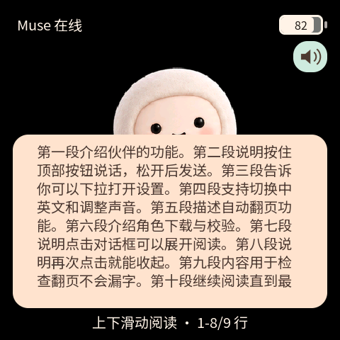

# Muse Charm · Mosaico

> **2.0 迁移候选分支**：应用和配套 Vibe Mode 已构建并通过新版官方包校验，
> 原始角色与手势界面已在新版模拟器验证；新版实机验收仍在进行。
> 安装说明和待验收项目见 [2.0 迁移说明](docs/V2_MIGRATION_CN.md)。
> 本分支不能直接用旧版固件或旧 Recovery 安装流程；已验证的一代见
> [main 分支](https://github.com/samyeei/Muse-charm-mosaico/tree/main)。

基于 Muse Gadget SDK 的 ESP-Mosaico 语音 AI 伙伴，支持按键对话、千问语音朗读、八种角色动态、手势设置、长回复滚动阅读、中英文界面与手机 Wi-Fi 配置，也能通过 Muse 生成并更换角色形象。

[English](README_EN.md) · [手机配置图文教程](docs/SETUP_CN.md) · [构建](docs/BUILDING.md) · [生成角色](docs/CHARACTERS_CN.md)

## 实机演示

[观看／下载演示视频](https://github.com/samyeei/Muse-charm-mosaico/raw/refs/heads/main/docs/assets/demo/muse-charm-demo.mp4) · 约 39 秒，含声音。展示对话、角色动态与设置；视频已移除拍摄定位信息并遮挡背景顶部名称区域。

## 功能

- 黑底奶白色原创角色，待机、聆听、思考、朗读、困倦、错误、开心、开机八种动态。
- 上方 AI 键按住说话、松开发送；喇叭按钮静音；下拉进入设置、上滑返回；轻触角色触发开心动画。
- 默认阿里百炼 Qwen3-TTS-Flash-Realtime / Cherry；支持硅基流动和 OpenAI 兼容 PCM 语音接口。
- 首次启动连接设备免密码 Wi-Fi，浏览器填写 Muse token 与 TTS 地址、Key、模型和音色，保存后热点关闭。
- 中英文设置；音量、亮度、语速、自动翻页间隔、5/10/15/20/30/60 秒熄屏可调。
- 点击回复框展开，文字左对齐并可上下滑动；点击框外收起。触摸、AI 键和主板运动唤醒。
- 支持 Muse 角色包任务、下载提示、完整性校验和 NAND 备份恢复；二代真机换装仍待验收。

## 需要准备

ESP-Mosaico 裸机、USB 数据线、Muse 手机 App 与 Muse Gadget SDK token，以及阿里百炼 API Key（北京地域）或其他兼容 TTS 服务凭据。每位使用者填写自己的凭据，仓库与固件不包含作者的 token、配对和 Wi-Fi 数据。当前版本不需要扩展插件；不支持视频播放，自动环境光亮度尚未接入。

## 让本地 Agent 帮你安装

把设备通过 USB 数据线连接电脑，打开可访问本机 USB 的 Codex 或其他本地 Agent，直接发送下面这句话：

> 请检查 https://github.com/samyeei/Muse-charm-mosaico 当前分支的发布状态：若是迁移候选，只完成依赖初始化、构建和模拟器预览，不安装；若是已通过真机验证的稳定版，再按仓库说明用 mosaico.py 安装到我的 USB Mosaico，保留身份、凭据与 NAND 数据，不整片擦除，并验证开机、配对、文字回复和朗读。

Agent 需要本地文件、网络与设备访问能力，可能会提示你授予权限或操作设备进入恢复模式。安装完成后，在手机配置页填写自己的凭据，详见 [手机配置图文教程](docs/SETUP_CN.md)。

## 2.0 迁移与安装状态

本分支使用 Vibe Mode 0.2 / Recovery ABI 2、GSP 1.5.1 和 gspc 0.6.1。
旧 ABI 1 设备须先经 ROM 迁移基础固件，再安装应用完整包；不能沿用一代更新顺序。
本分支尚未通过真机验收，先参阅 [迁移说明](docs/V2_MIGRATION_CN.md) 和
[构建说明](docs/BUILDING.md)。候选制品位于 `firmware/candidates/`，普通使用者请继续使用 main。

本分支的初始角色及阅读界面：

## 验证与限制

一代千问版本曾通过真机对话和朗读确认；这些历史结果不等于二代已通过验收。二代的构建、模拟器和待验收范围见迁移说明。模拟器使用相同 C 界面，但模拟云服务和音频，不能代替真机验收。初始角色动态是姿态图片的位置动画；生成角色可使用逐帧动画。第三方 TTS 必须匹配支持的协议与 PCM 格式，填写任意地址不代表自动兼容。

## 开源与依赖

应用源码采用 Apache-2.0，第三方代码和字体保留各自许可证，见 [NOTICE](NOTICE)。基于 [ESP-Mosaico Vibe](https://github.com/esp-mosaico/esp-mosaico-vibe) 与 [Muse Gadget SDK](https://github.com/facebookincubator/muse-gadget-sdk)。构建依赖固定提交记录于 [DEPENDENCIES.json](DEPENDENCIES.json)。内部固件工程名保留 `muse_companion`，公开仓库名为 `muse-charm-mosaico`。
