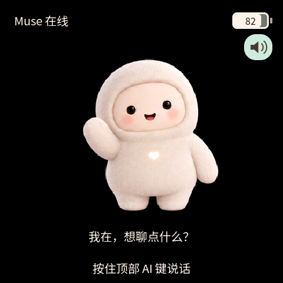

# Muse Charm 2.0 · 会聊天的毛绒 AI 伙伴

把 Muse 装进 ESP-Mosaico：按住顶部红色 AI 键说话，松开后发送，
屏幕显示回复，由阿里千问朗读。保留最初奶白色毛绒角色和纯黑背景。



## 能做什么

- 按住 AI 键录音，松开发送；文字回复、千问朗读、右上角一键静音。
- 中文/英文界面；设置音量、亮度、语速和 5/10/15/20/30/60 秒熄屏。
- 顶部下拉进入设置，上滑返回；点击对话框展开，上下滑动阅读，点框外收起。
- 连接设备免密码热点，在手机网页填写自己的 Muse token 与 TTS 服务参数。
- 八种角色状态；配套定制 Vibe Mode 实现角色下载、校验、NAND 备份与恢复。

## 安装与配置

本包需要 ESP32-S31 ESP-Mosaico，Vibe Mode 0.2 / Recovery ABI 2。
旧 ABI 1 设备须先完成一次官方 ROM 迁移，不能直接套用一代安装命令。
免电脑换装需要仓库配套的定制 Vibe Mode；普通官方基础固件不包含该模块。
不要整片擦除 Flash、清空 NAND，或安装旧 recovery-v4 ABI 1 包。

完整迁移与本地 Agent 安装说明：
https://github.com/samyeei/Muse-charm-mosaico/blob/main/docs/V2_MIGRATION_CN.md

已安装匹配基础固件的设备，在仓库 projects/muse_companion 目录运行：

```powershell
python ../../mosaico.py iris system-update --bundle "<下载目录>/muse-charm-v2.0.0.irisfw" --timeout 900
```

首次配置：手机连接屏幕显示的 Mochi-Setup 热点（无密码），浏览器进入
http://192.168.4.1，填写 Muse token 与千问 API Key、模型和音色，保存重启。
再到 Muse App 的设置→设备，打开 Developer mode，点击加号添加设备，
按设备顶部红色 AI 键确认，按照 App 提示输入常用 Wi-Fi 密码并配对。

图文教程及 API Key 获取入口：
https://github.com/samyeei/Muse-charm-mosaico/blob/main/docs/SETUP_CN.md

## 实测范围和当前限制

2026-10-23 已完成新版 ROM 迁移、完整包安装、官方制品校验、模拟器交互测试。
用户确认原始角色、语音对话、文字回复、千问朗读和手势交互正常，无黑屏或重启。
NAND 挂载与受保护的初始角色备份校验通过，未格式化。

二代新兼容角色包的自动下载、安装及恢复尚待联调，本次按用户要求先行上传，
不声明换装链路已完成新版真机验收。兼容标识尚未冻结，旧 v4 包必须重新打包。
初始角色为姿态图片配合位置动画；动态角色可使用逐帧素材。暂不支持视频。
自动环境光亮度尚未接入；填自定义 TTS 地址也必须匹配支持的协议与音频格式。

应用源码采用 Apache-2.0，第三方 SDK、字体和资源保留各自许可，详见仓库 NOTICE。
本固件不包含作者的 token、Wi-Fi 密码或配对数据。

项目开源地址：https://github.com/samyeei/Muse-charm-mosaico

后续更新在 GitHub 仓库。
